# AE 正式结果与完成边界

已完成六类 × 三个训练 seed，共18组，每组使用该类完整正常训练池，20张校准图全部排除。共2880张原尺寸测试预测；不缩小GT、不逐图归一化。
AE 是正常图训练扩展，不是1/2/4/8-shot。不得把它与 K-shot 方法称为相同训练预算的实验。三个 seed 仅改变训练初始化、增强和顺序。

|类别|正常训练图数/模型|Image AUROC|Pixel AUROC|误报率|漏报率|
|---|---:|---:|---:|---:|---:|
|candle|880|0.6602 ± 0.0205|0.8197 ± 0.0069|7.00%|75.67%|
|capsules|522|0.8641 ± 0.0144|0.8493 ± 0.0046|15.00%|28.33%|
|cashew|430|0.9221 ± 0.0084|0.2167 ± 0.0060|8.67%|25.33%|
|chewinggum|433|0.6977 ± 0.0674|0.5686 ± 0.0212|4.67%|76.33%|
|fryum|430|0.8279 ± 0.0186|0.6156 ± 0.0070|1.33%|46.00%|
|pipe_fryum|430|0.6943 ± 0.0691|0.7938 ± 0.2207|4.67%|76.67%|

六类等权 Image AUROC **0.7777 ± 0.0125**；Pixel AUROC **0.6440 ± 0.0319**。先按 seed 对六类等权平均，再取三个 seed 的均值/总体标准差。
校准阈值下误报率 6.89%，漏报率 54.72%。95%校准分位数不保证真实测试误报恰好5%。

下图为固定seed0的原始图像分数分布，黑色短线是20张正常校准图，红线仅由校准图确定。图用于事后解释，不用测试直方图重新挑阈值。
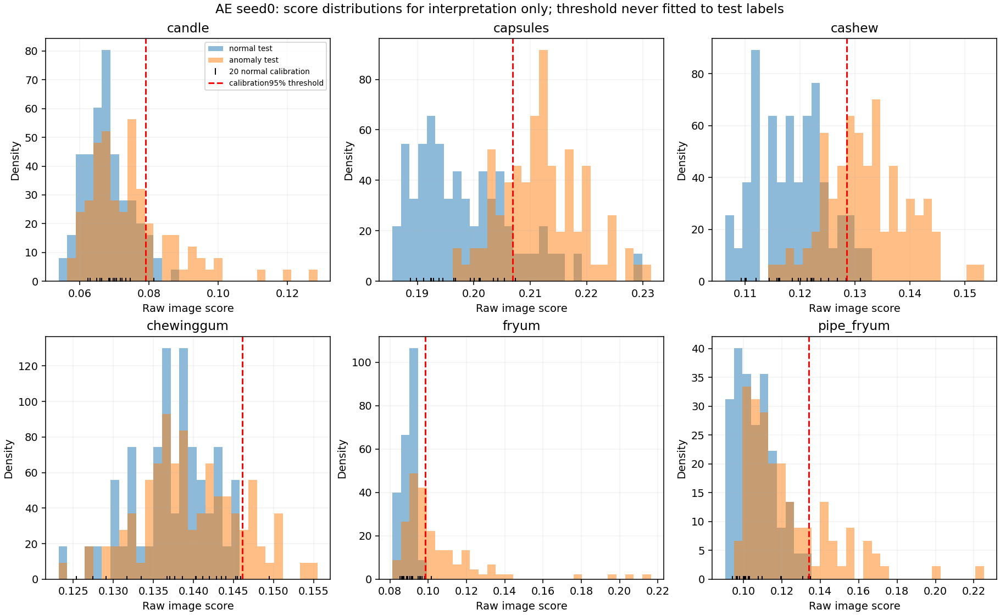

## 效率与保存

RTX4060 Laptop GPU 串行复测：**31.62 ms/图**，推理峰值 allocated GPU **30.22 MiB**。包括读图、预处理和恢复原尺寸，排除训练、压缩存盘和评价。18组全部测试图重新推理，图像分数与正式保存值逐个完全一致。
正式运行中存在两个独立类别 worker 并行，因此 raw run.json 中的首次墙钟耗时受竞争影响；报告速度以 serial_benchmark.json 为准。Template/ECC 是CPU运行，不能把这种硬件差异当成算法速度优势。
程序原始 summary.json 保留运行时的初次耗时，便于审计；对外使用 reported_summary.json，其中耗时已明确引用串行复测，精度与原汇总完全相同。
原始预测 float32 像素内容 16.09 GiB，无损 NPZ 实际 14.04 GiB；没有删除已有结果。模型18份、每份约0.4MB，已提供在 checkpoints/，与原始模型 SHA256 一致。

## 学到了什么、仍缺什么

重建模型用正常图学习局部颜色和纹理。正常训练 MSE 下降只能说明重建拟合，并不证明它能把真实异常和正常外观变化分开。压缩瓶颈可能抹去小缺陷，也可能同时平滑正常纹理；需要结合逐图分数、阈值与 GT 看实际结果。
额外用每类固定前8张正常训练图核查最终模型，并比较直接输出全黑的 MSE。这个检查只诊断训练质量，不用于删除 seed 或替换模型；完整数值见 training_quality_audit.json。
发现 1 组接近全黑重建的训练退化，仍全部纳入均值/标准差。这些运行的高 Pixel AUROC 也不一定代表细小缺陷识别好：整件亮产品对黑色重建都有误差，可能把产品前景当作异常。应同时看重建图和 AP/AUPRO，不能只挑高AUROC宣称成功。
后续改进应预先固定正常训练池内部的验证划分，研究较小学习率、避免 sigmoid 饱和的输出/损失或更稳定的初始化，再作为新的独立实验；不能根据这次测试成绩只重跑差的 seed。
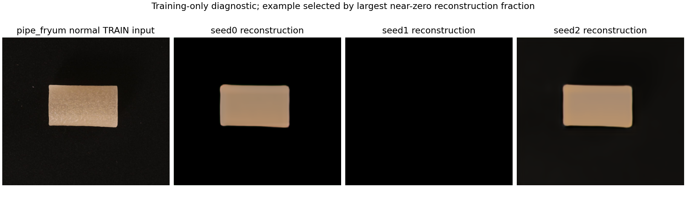
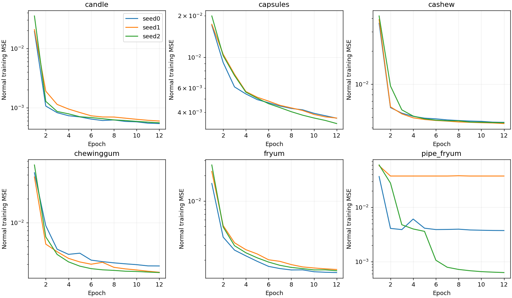

下面复用原 Template 已固定的六个困难案例，seed0；另补官方顺序首张Cashew异常图，作为事后定位诊断，不根据它的AE成绩挑选。Template/ECC 是8-shot，AE 使用完整正常池。热图仅展示统一0..0.25色标并可视化截断，计算指标时始终使用未归一化原值。局部 ROI 在评价后根据 GT 或正常图的基准最大响应确定，未用于模型训练或调参。

### candle/test/bad/026.JPG

真实标签 异常；AE OK，分数 0.07451 / 阈值 0.07912，仍判断错误。这是固定困难例的个案，不是总体成功率。
GT区域平均误差 0.08876，其余像素平均误差 0.01600；其余像素包括正常产品与背景，不能把这个数当独立背景因果实验。
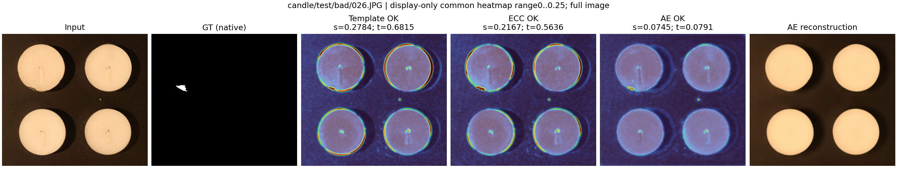
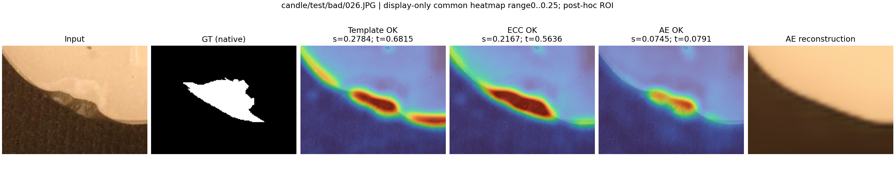

### capsules/test/bad/052.JPG

真实标签 异常；AE OK，分数 0.20564 / 阈值 0.20688，仍判断错误。这是固定困难例的个案，不是总体成功率。
GT区域平均误差 0.06838，其余像素平均误差 0.04100；其余像素包括正常产品与背景，不能把这个数当独立背景因果实验。
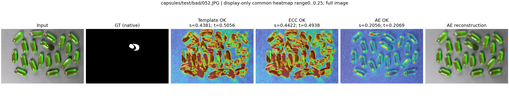
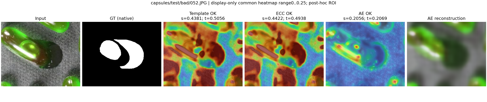

### cashew/test/good/344.JPG

真实标签 正常；AE OK，分数 0.12349 / 阈值 0.12850，判断正确。这是固定困难例的个案，不是总体成功率。
正常图没有GT缺陷；热图高响应应结合正常外形、纹理和光照分析，不虚构缺陷。
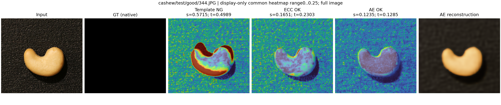
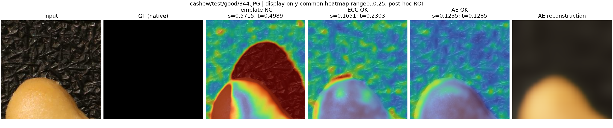

### chewinggum/test/bad/030.JPG

真实标签 异常；AE OK，分数 0.13483 / 阈值 0.14609，仍判断错误。这是固定困难例的个案，不是总体成功率。
GT区域平均误差 0.06905，其余像素平均误差 0.04152；其余像素包括正常产品与背景，不能把这个数当独立背景因果实验。
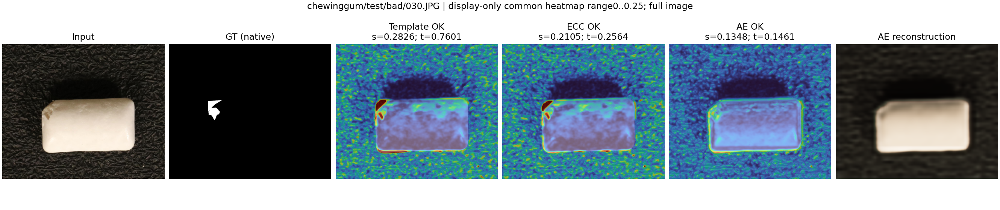
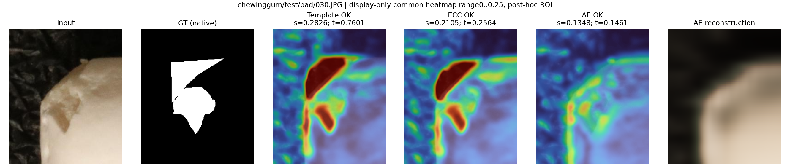

### fryum/test/good/392.JPG

真实标签 正常；AE OK，分数 0.09372 / 阈值 0.09847，判断正确。这是固定困难例的个案，不是总体成功率。
正常图没有GT缺陷；热图高响应应结合正常外形、纹理和光照分析，不虚构缺陷。
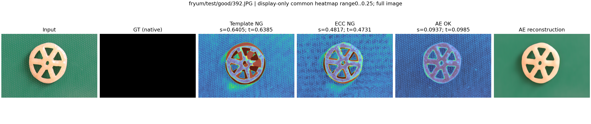
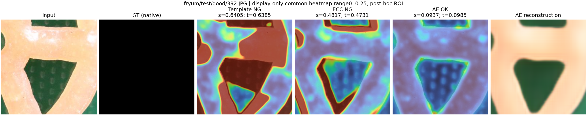

### pipe_fryum/test/bad/060.JPG

真实标签 异常；AE OK，分数 0.09903 / 阈值 0.13393，仍判断错误。这是固定困难例的个案，不是总体成功率。
GT区域平均误差 0.11452，其余像素平均误差 0.06585；其余像素包括正常产品与背景，不能把这个数当独立背景因果实验。
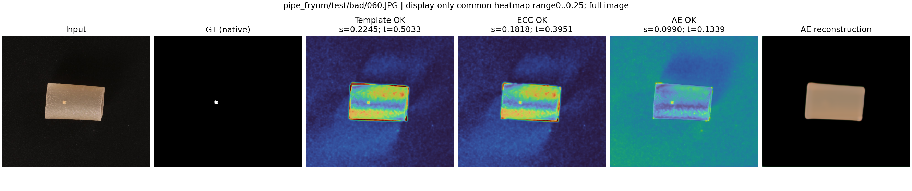
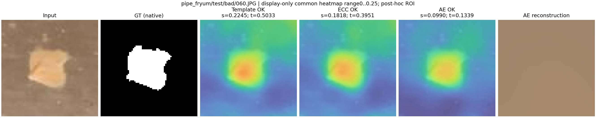

### cashew/test/bad/000.JPG

真实标签 异常；AE NG，分数 0.14244 / 阈值 0.12850，判断正确。这是固定困难例的个案，不是总体成功率。
GT区域平均误差 0.06017，其余像素平均误差 0.06830；其余像素包括正常产品与背景，不能把这个数当独立背景因果实验。
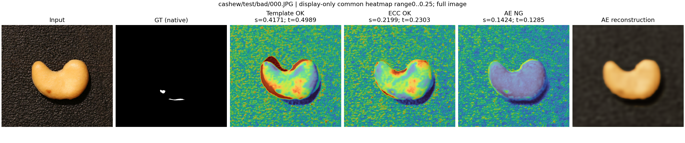
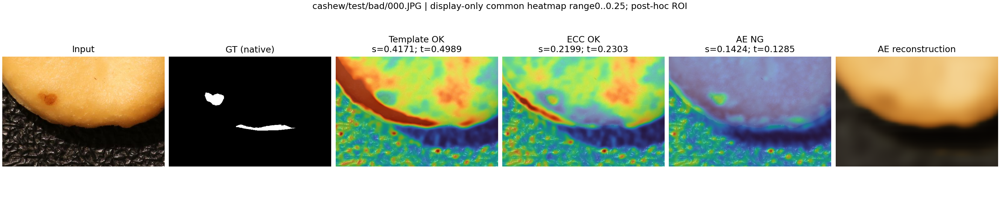

## 与分工的关系

A 的 Part1 Template、ECC 和本 AE 扩展均有正式六类实验。Part3 C 的生成器/评分头准备不等于训练完成；F 在这三个检测器上的计算也不等于 DINO+REVIEW。B 的新版 DINO 接口和正式结果未到位前，不能宣布 A 的所有 Part3 已完成。

人工查看后的逐例说明见 [人工案例核查](人工案例核查.md)。
