# AE人工案例核查（2026-11-14）

已查看全部七个案例的全图或局部对照及三个种子的正常训练图重建。前六例复用原Template固定案例；另一个是官方清单顺序首张异常Cashew图。所有观察均为评价后的解释，没有用来改模型、阈值或挑训练seed。

## candle/test/bad/026.JPG

蜡烛缺口在GT和误差图中有局部响应，重建图将边缘平滑。AE分数0.07451仍低于0.07912阈值，属于有局部提示但整图漏报，不能说模型完全看不到缺口。

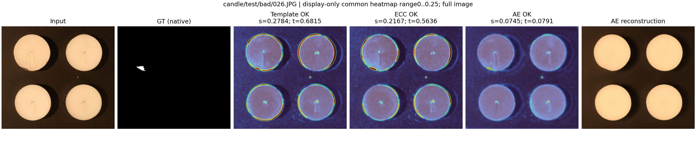
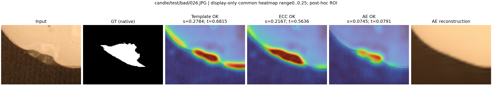

## capsules/test/bad/052.JPG

胶囊端部缺损的GT呈片状，但AE较强响应还集中于正常高光和表面纹理；重建图把胶囊与灰色背景都明显抹平。分数0.20564仅略低于0.20688阈值，依旧漏报。不能因为接近阈值就在测试图上改阈值。

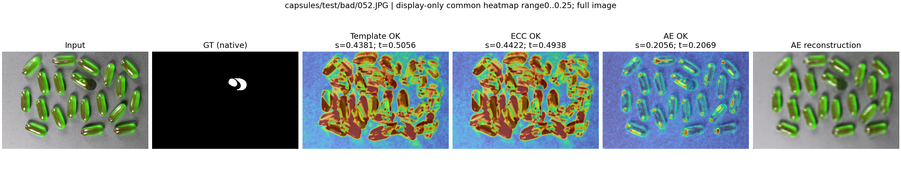
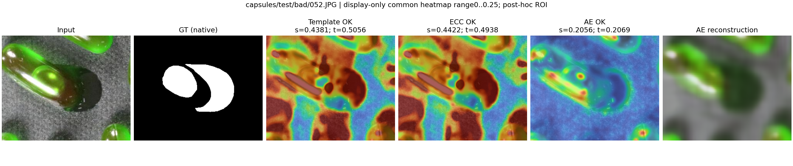

## cashew/test/good/344.JPG

这是一张正常图，AE和ECC都判OK，修正了原Template的误报。AE主体内部响应较弱，复杂的正常背景纹理反而到处有响应；正常图没有GT缺陷，不能把热图亮点虚构成缺陷。

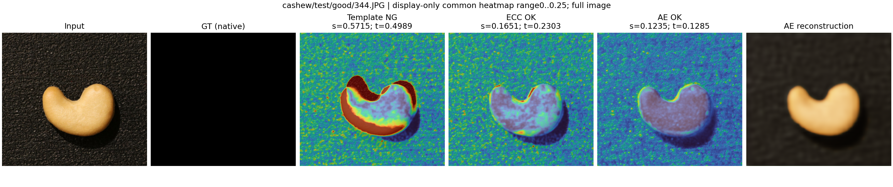
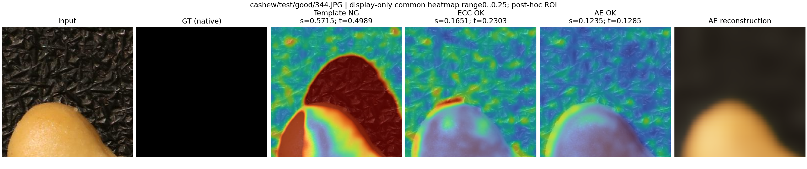

## chewinggum/test/bad/030.JPG

缺损在原图清晰可见，AE重建把边缘与缺损过度平滑。AE在缺口与正常边缘均有响应，未形成足够高的整图分数，0.13483低于0.14609，仍漏报；并非看到热图亮就等于检测成功。

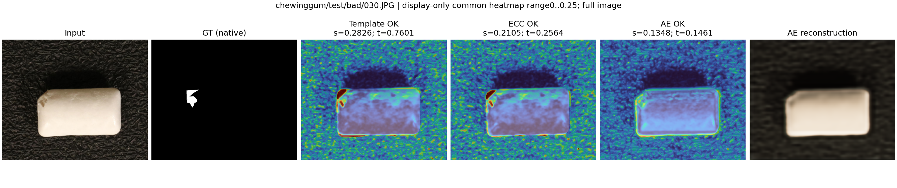
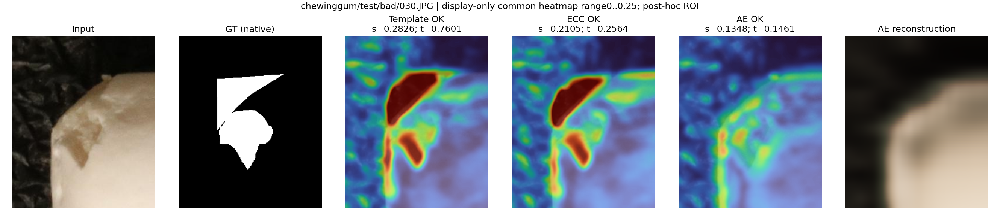

## fryum/test/good/392.JPG

这是正常轮形产品。Template/ECC在轮辐和轮廓处有大面积差异而误报；AE学到了大致轮形，整体误差降低，本例正确判OK。正常背景网格仍有残差，不能据此保证全部背景变化都能被消除。

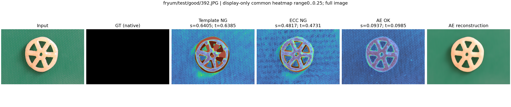
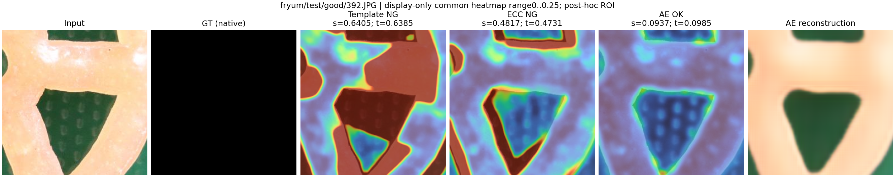

## pipe_fryum/test/bad/060.JPG

小缺陷在GT和局部误差图中有圆状响应；AE重建几乎成为均匀色块，丢失了细小表面纹理。图像分数0.09903低于0.13393，仍漏报。该图说明局部像素响应与校准后的整图决策必须分开看。

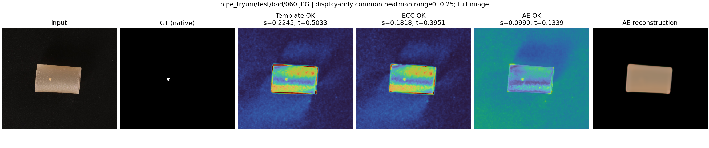
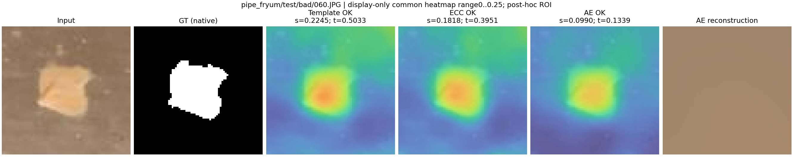

## cashew/test/bad/000.JPG

这是按官方清单顺序补选的首张异常腰果图。AE分数0.14244超过0.12850，整图判断正确；但热图对大范围正常背景的响应强于多数腰果表面，GT棕斑处仅有较小响应。重建图把背景纹理抹掉，因此产生大量背景误差。它解释了整图AUROC较高而定位差可以同时出现，但不是独立的背景因果消融。

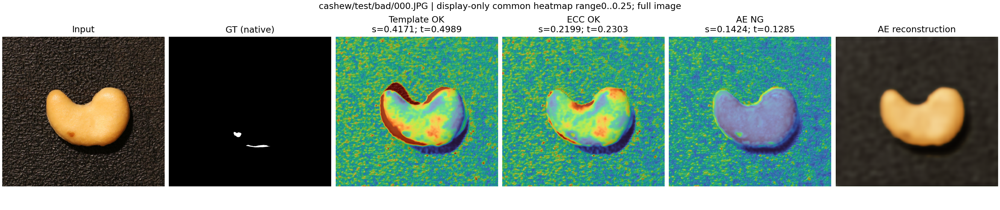
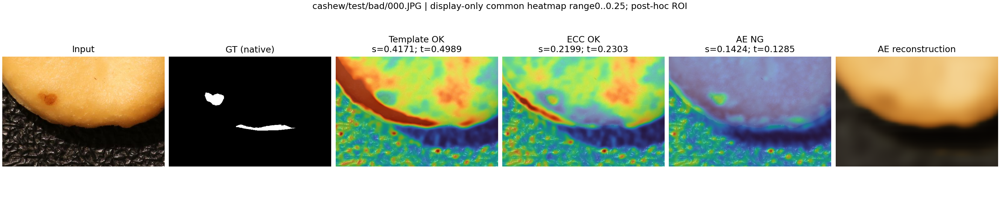

## 训练退化

Pipe_fryum seed1的重建全黑；首8张正常训练图上，最终模型MSE与全黑预测相同，重建值低于1e-4的比例为100%。seed0和seed2仍能恢复大致产品轮廓。这个检查没有读取校准/测试标签，也没有删除seed1的测试成绩。较高的Pixel AUROC不能单独证明该模型能定位真实细小缺陷。

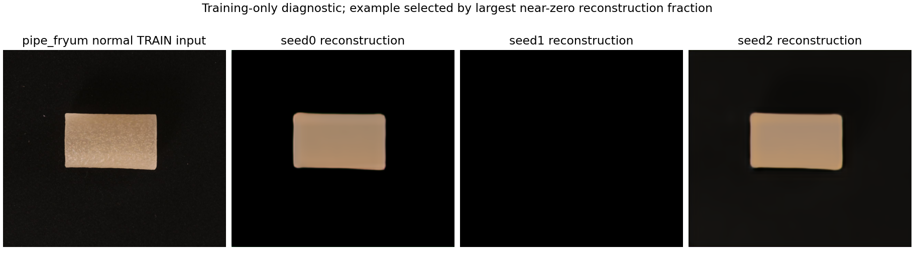
