# ECC 完整 72 组配准对照结果

## 完成情况

六类 × 1/2/4/8-shot × 三 seed，共 72 组正式 ECC 对照已完成。逐张核对与基准所选参考及旋转角度一致，校准和测试清单完全一致。仅新增配准；差异、后处理、评分和原尺寸评价规则保持不变。每个方法用相同 20 张正常图计算各自阈值。输入短边为 448；ECC 只在最长边 224 的灰度副本上估计变换，再换算到输入尺寸配准参考。测试图和原始 GT 保持不动。

均值为六类等权宏平均；标准差来自三个参考 seed（ddof=0）。配对变化的标准差直接由三个 seed 的差值计算，不是两组标准差相减。

| shot | 基准 Image AUROC | ECC Image AUROC | 基准 Pixel AUROC | ECC Pixel AUROC | 基准 FNR | ECC FNR | 基准/ECC FPR | 基准/ECC CPU ms |
|---|---|---|---|---|---|---|---|---|
| 1 | 0.5074 ± 0.0133 | 0.5877 ± 0.0326 | 0.7541 ± 0.0056 | 0.7530 ± 0.0094 | 0.8439 | 0.7078 | 0.1057 / 0.2043 | 36.17 / 55.10 |
| 2 | 0.5477 ± 0.0530 | 0.6290 ± 0.0392 | 0.7621 ± 0.0083 | 0.7646 ± 0.0093 | 0.8639 | 0.7228 | 0.0448 / 0.1483 | 34.39 / 52.49 |
| 4 | 0.5831 ± 0.0379 | 0.6328 ± 0.0135 | 0.7668 ± 0.0038 | 0.7713 ± 0.0013 | 0.8556 | 0.7233 | 0.0620 / 0.1291 | 34.53 / 48.90 |
| 8 | 0.6128 ± 0.0064 | 0.6383 ± 0.0109 | 0.7669 ± 0.0022 | 0.7700 ± 0.0025 | 0.8706 | 0.7350 | 0.0517 / 0.1144 | 35.16 / 48.74 |

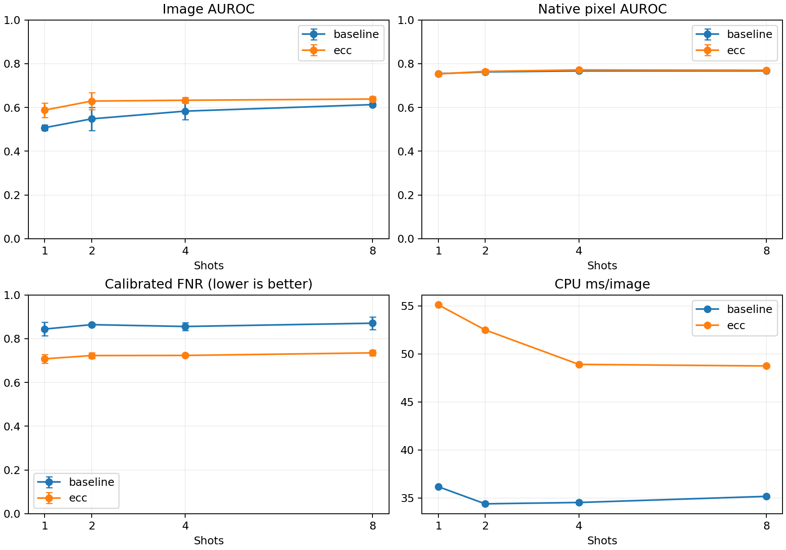

## 配准状态

| shot | 测试预测总次数 | 接受配准 | 回退 |
|---|---|---|---|
| 1 | 2880 | 2857 | 23 |
| 2 | 2880 | 2865 | 15 |
| 4 | 2880 | 2872 | 8 |
| 8 | 2880 | 2869 | 11 |

回退图仍进入全部指标，未删除困难样本。每图回退原因、有效范围、相关性和矩阵保存在各组 alignment_traces.json。`aligned` 只表示满足预设的几何范围、重叠和相关性条件，不等于与真实物体精确对应，也不等于检测正确。

## 沿用基准的六个困难案例

样本沿用基准已选好的 8-shot seed 0 六例，没有根据 ECC 成绩改选好看的案例。两张热图共用 0–0.5 显示范围，指标仍用完整原始浮点值；青色为 GT。1 表示判 NG，0 表示判正常。

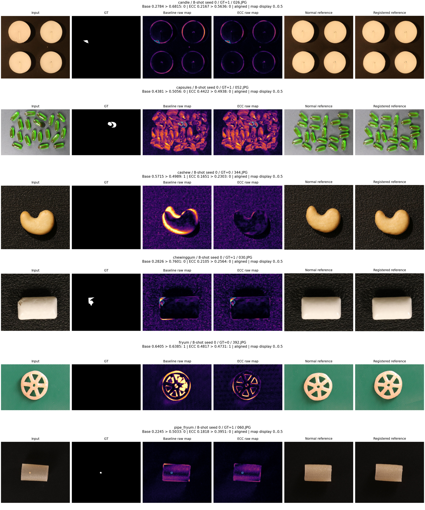

局部放大图仅用于事后观察：异常图取 GT 包围框并扩展上下文，正常图取基准热图峰值附近。区域不用于推理、参数选择或修改任何评价分数。

### candle：这例仍判断错误

GT=1；基准判定=0，ECC 判定=0；配准状态=aligned。

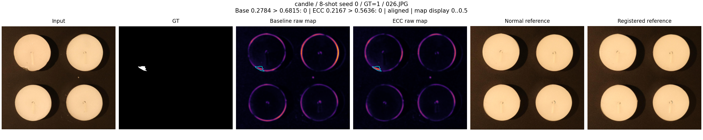

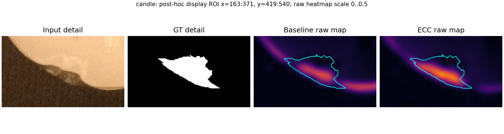

### capsules：这例仍判断错误

GT=1；基准判定=0，ECC 判定=0；配准状态=aligned。

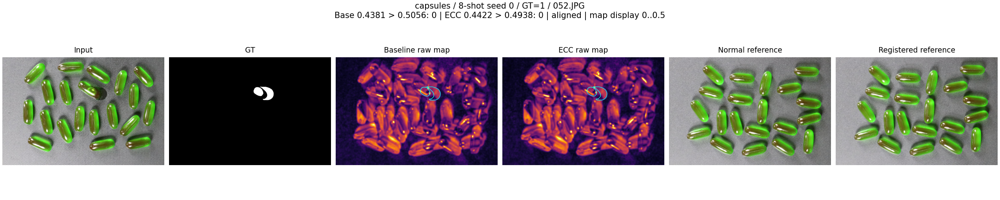

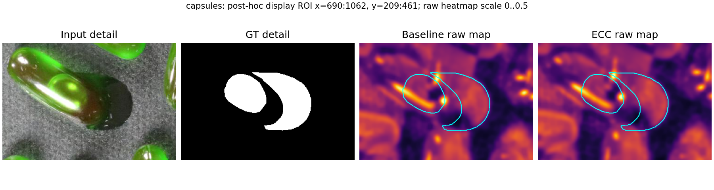

### cashew：纠正了这例判断

GT=0；基准判定=1，ECC 判定=0；配准状态=aligned。

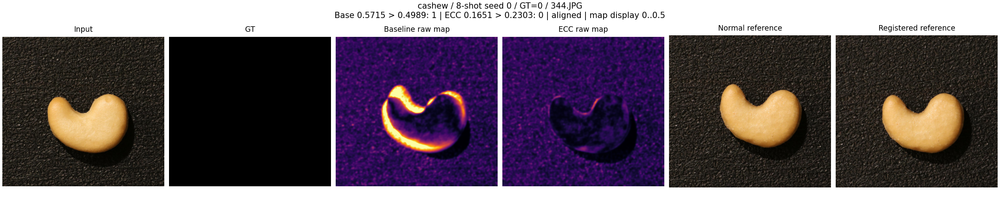

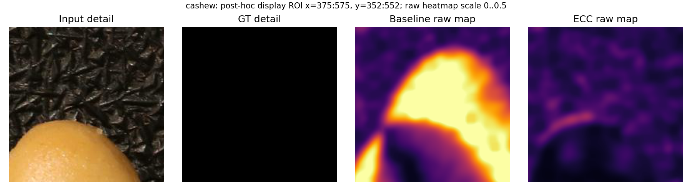

### chewinggum：这例仍判断错误

GT=1；基准判定=0，ECC 判定=0；配准状态=aligned。

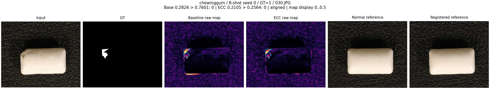

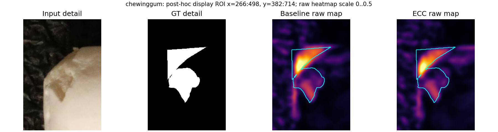

### fryum：这例仍判断错误

GT=0；基准判定=1，ECC 判定=1；配准状态=aligned。

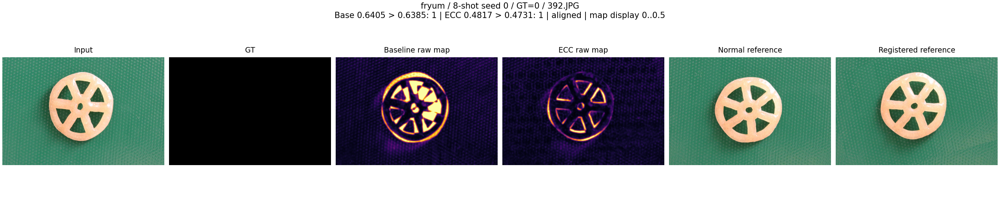

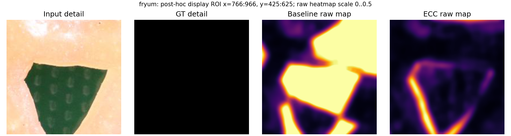

### pipe_fryum：这例仍判断错误

GT=1；基准判定=0，ECC 判定=0；配准状态=aligned。

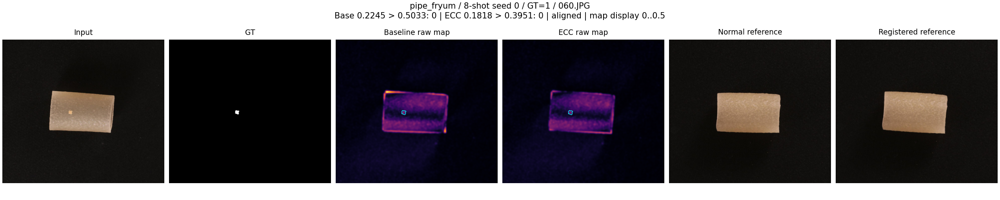

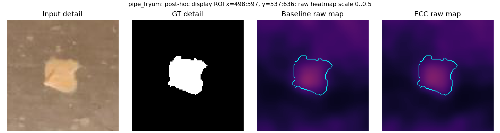

## 限制与文件入口

完整性通过不代表每类效果均提升，请同时查看各类和每个 shot 的 paired_comparison.csv；AP、AUPRO、FPR/FNR 及配对变化均已保留。ECC 是预先列入分工的选做方向，本轮没有按测试成绩修改配准参数。使用相同公开测试集进行方法对照，不声称这是对全新未见数据的验证。

采用 CPU 四个 OpenCV 线程。计时包含读图、预处理、模板选择、ECC 与检查、后处理和原尺寸恢复，不含保存及指标评价。GPU 未使用，显存记录 0；与 GPU 神经模型仍存在设备可比性限制。全部变换与失败策略见 methods/part1/ECC对照方案.md。

轻量分数、校准分数、完整预测清单和配准日志在 runs/；原始预测在本机 outputs/part1_ecc_full_v1/。AE、Part 3 C/F 和最终报告/提交仍需另行完成。

## 原始预测存储

11,520 个原始预测路径全部保留，其中 4,272 次写出使用字节完全相同的硬链接共享，累计避免约 23.87 GiB 重复存储。没有压缩精度或缩小标注；逐图共享发生在推理计时之外。逻辑文件大小按路径相加仍可能很大，磁盘实际占用因共享而减少。

逐例人工观察、改善与退步的解释，以及 A 的剩余任务见 [案例核查与大白话结论](案例核查与结论.md)。
