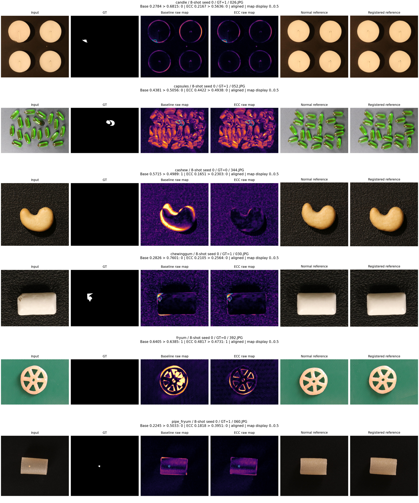
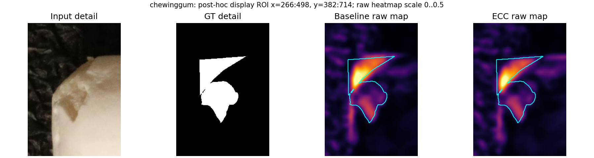
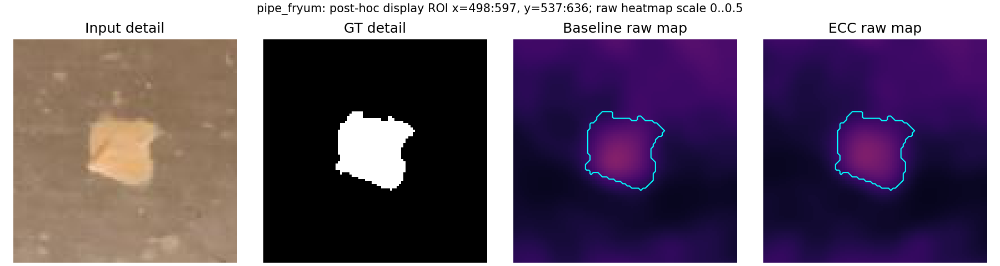

# ECC 做完后，大白话看结果

本轮六类、四个 shot、三个 seed，共 72 组正式对照已完成。完整性检查通过，说明实验和记录齐全；模型仍然比较弱，不能因此说检测已经可靠。

## 到底有没有帮助

四个 shot 的平均 Image AUROC 都比未配准基准高，但改善幅度和类别差别很大。以预先固定展示的 8-shot 为例：

| 项目 | 原基准 | ECC | 实际含义 |
|---|---:|---:|---|
| Image AUROC | 0.6128 | 0.6383 | 整图异常分数的排序小幅改善 |
| Pixel AUROC | 0.7669 | 0.7700 | 平均像素定位改善很小 |
| 漏报率 FNR | 87.1% | 73.5% | 少漏一些，但依然漏掉很多异常 |
| 误报率 FPR | 5.2% | 11.4% | 正常图被误判为异常的情况增加 |
| CPU 平均耗时 | 35.16 ms/图 | 48.74 ms/图 | 本机本轮测量增加约 38.6% |

这里的误报/漏报是先逐类计算、再六类等权平均，不是把不同类别数量直接混起来。每个配置都使用规定的同一批 20 张正常图，分别计算该方法的 95% 分位阈值，没有按测试标签修改阈值。

8-shot 的 Image AUROC 改善主要来自 Cashew 和 Chewinggum；Candle 略退步，Capsules 和 Pipe_fryum 基本不变，Fryum 也有退步。Pixel AUROC 虽有五类上升，但 Fryum 从 0.7726 降至 0.7267，抵消了不少收益。因此不能只挑改善的类别宣布 ECC 全面优于基准，也不能只报漏报下降而省略误报上升。

三 seed 的标准差反映这三组共享参考选择的波动，不是对所有未来产品的置信保证。两种方法在同一台机器使用 CPU，完整计时范围和依赖均已保存；这不是与 B 的 GPU 模型直接排速度的依据。

## 看过六个固定案例后，具体发现了什么

案例沿用原基准已选好的 8-shot、seed 0 六张图，没有为了展示 ECC 重新挑样本。下面是一张正常腰果误报被纠正、其余五张仍判断错误；这个数字描述的是刻意选取的困难案例，不能当作整个测试集的错误率。

1. **Candle：缺口仍漏报。** 左上蜡烛边缘缺口在 GT 中可见。配准减少了一些轮廓错位响应，但四个蜡烛的正常外缘仍有残差。缺口的整图分数从 0.2784 降至 0.2167，ECC 的正常校准阈值为 0.5636，仍被判正常。一个整图刚性变换不能保证四个物体分别完全重合，几何处理也没有解决局部缺陷与整图评分的关系。

2. **Capsules：每颗胶囊各自移动，仍漏报。** 参考图和测试图中，多颗胶囊的位置、朝向不同。ECC 后热图仍在很多胶囊轮廓上广泛响应；分数 0.4422 仍低于阈值 0.4938。这里一次整图平移/旋转无法分别对齐每一颗胶囊。程序的 `aligned` 表示满足相关性和变换范围检查，并不表示每颗胶囊对齐正确。

3. **Cashew：正常腰果误报被纠正。** 原来最亮的是正常腰果外缘的错位。配准后测试图与参考的主体位置更一致，外缘高响应明显减少，分数从 0.5715 降至 0.1651，低于 ECC 阈值 0.2303，成功判回正常。这是单个主体整体位置/角度变化较适合刚性配准的一个实际例子，不能保证处理所有天然外形差异。

4. **Chewinggum：局部缺口有响应，仍未达到整图阈值。** 放大图可以看到左上缺损处，两种方法均有较强局部响应；ECC 减弱了一些正常外轮廓差异，但整图分数 0.2105 仍低于阈值 0.2564，继续漏报。此例不是完全看不到缺陷，而是局部热图响应仍不能支持正确的整图判定。

5. **Fryum：正常轮形产品仍误报。** 配准减少了部分大块错位，但轮辐和孔洞附近还有明显差异。分数虽然从 0.6405 降至 0.4817，阈值也因正常校准图的配准分数而降至 0.4731，因此仍略超阈值。分数变小不自动等于判断正确；正常形状差异和背景纹理也没有被整图刚性变换完全处理。该类整体 Pixel AUROC 退步是真实结果，不能用这一张图的视觉变化替代全类指标。

6. **Pipe_fryum：小白点仍漏报。** 局部放大图中，GT 白点在两种热图里都只有较弱、平滑的响应，其他表面纹理和边缘仍有残差。分数从 0.2245 降至 0.1818，低于 ECC 阈值 0.3951。缺陷仅占全图约 0.056%；最高 1% 像素均值这一整图评分方式可能稀释很小的缺陷，但这个解释仍需独立评分消融验证。

背景纹理和表面明暗的残差在图中可见，但本轮没有单独隔离它们做 ECC 光照/背景因果实验，不能为这些因素编造独立贡献比例。ECC 只改变几何位置，不拟合 RGB 亮度增益。旧基准的正常图亮度诊断仍属于旧基准，不能直接当成 ECC 的光照测试结果。

## 哪些已经 OK，哪些还需要做

已完成：完整 72 组、相同参考和旋转选择的逐图核对、同样校准/测试清单、原尺寸像素评价、三 seed 统计、AP/AUPRO、CPU 耗时与设备记录、回退日志、六例前后图及小缺陷放大图。每一张回退图都参加评价，未删除失败样本。新增预测采用无损硬链接共享，保留全部路径和原始浮点内容。

仍需改进：检测效果和误报/漏报取舍；多物体独立姿态、正常个体形状和微小缺陷的处理；与 GPU 神经模型的设备可比性。后续应使用训练/校准数据设计新的方法或消融，不依据这批测试标签反复挑参数，再把最好的结果当作独立验证。

按原分工尚未完成：Autoencoder、Part 3 C（合成缺陷）和 F（选择性预测）、最终课程报告/展示/提交。本轮完成只代表 Template + ECC 这部分正式实验和分析已经具备可核查结果。

## 给 B 看哪些文件

- `paired_comparison.csv/json`：全部类别、shot 的基准/ECC 均值、标准差、配对变化、FPR/FNR、AP/AUPRO、耗时。
- `runs/<category>/<shot>shot_seed<seed>/`：指标、校准分数、逐图分数、完整预测清单和配准轨迹。
- `completion_audit.json`：72 组、11,520 张原尺寸预测及源代码/参考一致性核查。
- `ECC结果与基准对照.md`：完整曲线与六例全图、局部图。

原始 `.npy` 留在运行机器的 `outputs/part1_ecc_full_v1/`，没有放进 GitHub。独立重算像素指标仍需这些原始预测及数据集；只看汇总和逐图判断不需要下载原始热图。
