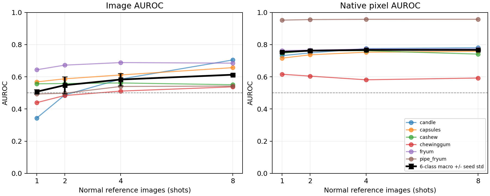
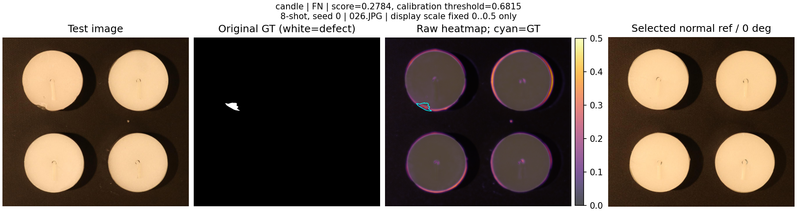
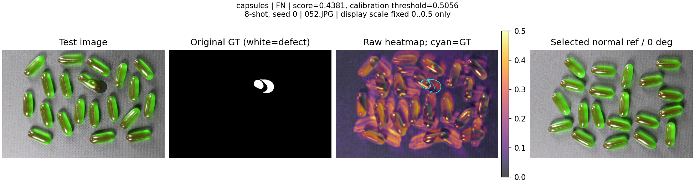
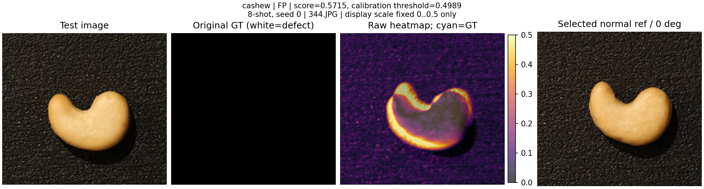
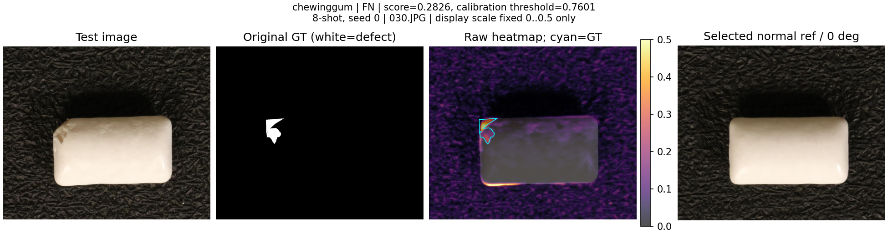
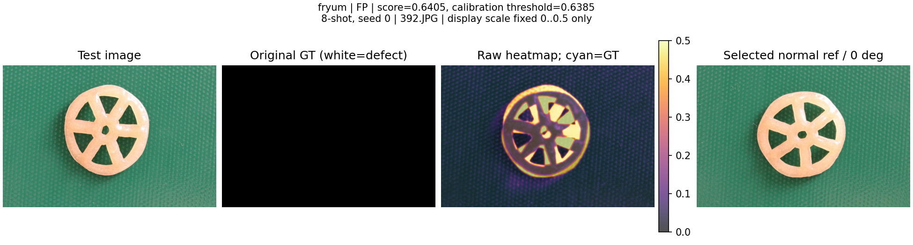
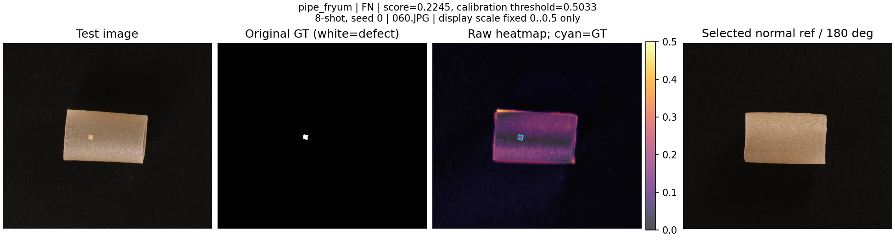

# Part 1 Template 正式实验结果

## 完成范围

已完成六类 × 1/2/4/8-shot × 三个参考 seed（0/1/2）共 **72 组正式 Template 实验**。每组使用完整官方测试集；六类共 960 张，跨配置共保存 11,520 张原尺寸预测图。全部记录为 `integration_only=false`，与旧的 Candle 联调成绩分开。

**这份结果只代表 Template 基准完成，不代表 A 的全部工作、ECC、Autoencoder、Part 3 或最终提交完成。**

## 方法与评价

- 使用冻结清单中的真实 K 张正常参考图及八角度旋转，不增加额外真实训练图。
- 输入短边 448，等比例缩放后从右侧/底部裁到 14 的倍数；以 28×28 RGB 描述子选最近模板。
- RGB 绝对差、Gaussian sigma=2、3×3 灰度闭运算；输入差异图最高 1% 像素的均值作为整图分数。
- 预测图线性插值回原图尺寸；GT 保留原尺寸，正常测试图的全零 GT 也参与像素评价。
- 每类固定 20 张正常校准图，仅用于线性插值的 95% 分位阈值；分数严格大于阈值判 NG。
- 未用测试集调参、选择最佳 seed、逐图 min–max 或更换正式结果。源码哈希见 `frozen_config.json`。
- 三个 seed 反映不同共享参考块；先算每个 seed 的六类等权均值，再报三 seed 均值和总体标准差（ddof=0）。

## 六类宏平均

指标范围 0–1；AUROC 越高越好，FPR/FNR 越低越好。0.5 是随机排序的 AUROC 参考值。

| shot | Image AUROC | Pixel AUROC | Image AP | Pixel AP | AUPRO@0.3 | FPR | FNR | CPU ms/图 |
|---|---|---|---|---|---|---|---|---|
| 1 | 0.5074 ± 0.0133 | 0.7541 ± 0.0056 | 0.6714 ± 0.0092 | 0.0680 ± 0.0016 | 0.4436 ± 0.0122 | 0.1057 ± 0.0356 | 0.8439 ± 0.0310 | 36.17 |
| 2 | 0.5477 ± 0.0530 | 0.7621 ± 0.0083 | 0.6984 ± 0.0420 | 0.0813 ± 0.0015 | 0.4760 ± 0.0314 | 0.0448 ± 0.0212 | 0.8639 ± 0.0082 | 34.39 |
| 4 | 0.5831 ± 0.0379 | 0.7668 ± 0.0038 | 0.7169 ± 0.0288 | 0.0902 ± 0.0007 | 0.4870 ± 0.0199 | 0.0620 ± 0.0097 | 0.8556 ± 0.0180 | 34.53 |
| 8 | 0.6128 ± 0.0064 | 0.7669 ± 0.0022 | 0.7407 ± 0.0083 | 0.0955 ± 0.0036 | 0.4924 ± 0.0038 | 0.0517 ± 0.0253 | 0.8706 ± 0.0293 | 35.16 |

## 8-shot 各类结果

8-shot 是预先指定的展示配置，不表示依据测试成绩选择了最佳配置。其他 shot 见 `summary.csv`。

| 类别 | Image AUROC | Pixel AUROC | FPR | FNR |
|---|---|---|---|---|
| candle | 0.7046 ± 0.0591 | 0.7802 ± 0.0023 | 0.0033 ± 0.0047 | 0.9967 ± 0.0047 |
| capsules | 0.6568 ± 0.0509 | 0.7582 ± 0.0044 | 0.0667 ± 0.0000 | 0.8133 ± 0.0741 |
| cashew | 0.5507 ± 0.0746 | 0.7409 ± 0.0175 | 0.0667 ± 0.0411 | 0.7767 ± 0.0602 |
| chewinggum | 0.5377 ± 0.0336 | 0.5924 ± 0.0068 | 0.0067 ± 0.0094 | 0.9633 ± 0.0262 |
| fryum | 0.6847 ± 0.0125 | 0.7726 ± 0.0064 | 0.0533 ± 0.0471 | 0.8667 ± 0.0386 |
| pipe_fryum | 0.5425 ± 0.0066 | 0.9573 ± 0.0026 | 0.1133 ± 0.1050 | 0.8067 ± 0.1109 |

## 六个困难案例

固定观察 8-shot、seed 0，每类选一个案例；交替优先展示误报和漏报，具体规则见分析程序。这些是每类较严重的错误示例，并非随机抽样或错误率估计；优先类型不存在时如实展示另一类型。案例用于解释已经冻结的模型，不回头调参。热图显示范围统一为 0–0.5，超范围仅在画图时截色，评价仍使用完整原始浮点预测。青色轮廓是原始 GT。

### 1. candle：FN

测试图 `candle/test/bad/026.JPG`，分数 0.2784，正常校准阈值 0.6815。GT 缺陷占全图 0.191%；热图最高 1% 区域中，落入 GT 的比例为 3.340%。该重合率仅辅助理解热图，不是课程的独立评价指标。

人工查看原图、GT、热图与参考后的观察：左上蜡烛的边缘有缺口，GT 只标注这块小区域。热图对多个正常蜡烛的外轮廓也有响应，缺口没有形成足够突出的整图分数；0.2784 低于正常校准阈值 0.6815，因此漏报。缺陷面积仅约 0.19%，最高 1% 像素求均值也可能稀释小缺陷响应。后续应独立验证配准能否降低正常轮廓差异，并用训练/校准数据研究评分方式。

### 2. capsules：FN

测试图 `capsules/test/bad/052.JPG`，分数 0.4381，正常校准阈值 0.5056。GT 缺陷占全图 0.904%；热图最高 1% 区域中，落入 GT 的比例为 4.760%。该重合率仅辅助理解热图，不是课程的独立评价指标。

人工查看原图、GT、热图与参考后的观察：测试图与参考图中，多颗胶囊的位置和朝向明显不一致；热图在很多正常胶囊轮廓上都很亮，GT 附近的差异没有占据主导。整图分数 0.4381 低于阈值 0.5056，造成漏报。一次整图 ECC 变换未必能同时对齐各自移动的胶囊，后续还需要与局部特征方法比较。

### 3. cashew：FP

测试图 `cashew/test/good/344.JPG`，分数 0.5715，正常校准阈值 0.4989。GT 缺陷占全图 0.000%；热图最高 1% 区域中，落入 GT 的比例为 0.000%。该重合率仅辅助理解热图，不是课程的独立评价指标。

人工查看原图、GT、热图与参考后的观察：这是一张正常腰果图，GT 全黑。测试腰果与正常参考的外形、轮廓位置不完全相同，热图最强响应沿着正常腰果的外缘，而不是某个真实缺陷；分数 0.5715 超过阈值 0.4989，因此误报。背景纹理也出现差异，但最强响应集中在主体轮廓。可以验证几何配准的作用，同时保留正常个体形状差异无法被刚性对齐完全消除的限制。

### 4. chewinggum：FN

测试图 `chewinggum/test/bad/030.JPG`，分数 0.2826，正常校准阈值 0.7601。GT 缺陷占全图 0.663%；热图最高 1% 区域中，落入 GT 的比例为 35.484%。该重合率仅辅助理解热图，不是课程的独立评价指标。

人工查看原图、GT、热图与参考后的观察：口香糖左上角的缺损在原图可见，热图在该处已有局部响应，并非完全看不到缺陷；底边和背景纹理也有响应。最终分数只有 0.2826，远低于正常校准阈值 0.7601，仍被判为正常。这说明局部响应与整图判定应分开分析；应保持规定的校准规则，优先改善分数对正常外观变化的稳定性。

### 5. fryum：FP

测试图 `fryum/test/good/392.JPG`，分数 0.6405，正常校准阈值 0.6385。GT 缺陷占全图 0.000%；热图最高 1% 区域中，落入 GT 的比例为 0.000%。该重合率仅辅助理解热图，不是课程的独立评价指标。

人工查看原图、GT、热图与参考后的观察：这是正常轮形产品，GT 全黑。测试图与参考图的轮辐角度、孔洞和边缘没有完全重合，热图在轮辐间形成块状高响应。分数 0.6405 仅略高于阈值 0.6385，属于接近判定边界的误报。配准可能减少整体位置/角度差异，但不能据此保证消除正常形状差异。

### 6. pipe_fryum：FN

测试图 `pipe_fryum/test/bad/060.JPG`，分数 0.2245，正常校准阈值 0.5033。GT 缺陷占全图 0.056%；热图最高 1% 区域中，落入 GT 的比例为 0.367%。该重合率仅辅助理解热图，不是课程的独立评价指标。

人工查看原图、GT、热图与参考后的观察：原图中间的小白点是 GT 缺陷，面积仅约 0.056%。热图较强响应出现在产品上边缘和表面的大范围纹理差异，小白点没有成为主导；整图分数 0.2245 低于阈值 0.5033，因此漏报。该类平均 Pixel AUROC 很高也不能保证每个微小缺陷均被抓到；后续需要针对小缺陷响应和整图分数做独立验证。

## 耗时、内存与限制

当前为四 OpenCV 线程的 CPU 实现，机器和依赖写在每组 `metrics.json` 的 resources 中。每图耗时包含读 JPG、预处理、选模板、差分、后处理和恢复原尺寸；不包含参考库构建、预热、校准、保存预测图和指标计算。参考库构建耗时另行保存。

**GPU 未使用，GPU 显存记为 0；不能把这解释为 GPU 版本的显存成绩，也不能据此直接宣称比 GPU 上的 DINO/CLIP 更快。**若最终表格要求所有方法在同一 GPU 上测量，这项硬件可比性仍需补充。进程 RSS 是推理期间采样到的最大值，不是操作系统捕获到的绝对内存峰值。

模板只选整体最接近的参考图及离散旋转，没有 ECC 几何配准。位置、局部姿态、形状、阴影或亮度变化可能形成强差异；是否构成某个案例的主要原因，还要结合图像逐例判断，不能仅凭低 AUROC 断言。

## 给 B 的使用方式

- 汇总表使用 `summary.csv` 或 `summary.json`；逐组数据在 `runs/<category>/<shot>shot_seed<seed>/metrics.json`。
- 各测试图分数、阈值、预测与参考选择在同目录的 `image_predictions.csv`，便于对照同一测试图。
- `calibration_scores.csv` 保存真实 20 张校准图分数；`prediction_manifest.json` 保存原始预测清单和热图哈希。独立重算像素指标仍需要本机原始热图。
- 72 组完整性与源码核查记录见 `completion_audit.json`。原始大体积预测在本机 `outputs/part1_template_v1/`，不进入 Git。
- 与 DINO/CLIP 合并报告时分别保留方法、shot、参考 seed/运行 seed、设备和协议标识，不混用旧联调成绩。

## 还没有完成的项目

ECC 改进、Autoencoder、A 负责的其他 Part 3 实验及最终报告/展示/提交，不在本轮完成范围内。Template 实验完整和 Template 准确率理想是两件事；低于随机参考水平的结果也照实保留。

## 正常图外观敏感性诊断

**以下只诊断正常校准图，不是独立测试准确率，也不并入 72 组正式指标。**固定各类 8-shot、seed 0 与原始阈值；对同一批 20 张正常校准图，分别平移宽高的 3%，或把 RGB 亮度乘以 1.15。参数不随结果调整。表中为被判成 NG 的张数（总数 20）。

| 类别 | 原图 NG/20 | 平移后 NG/20 | 增亮后 NG/20 |
|---|---|---|---|
| candle | 1 | 1 | 10 |
| capsules | 1 | 1 | 0 |
| cashew | 1 | 6 | 6 |
| chewinggum | 1 | 4 | 3 |
| fryum | 1 | 8 | 2 |
| pipe_fryum | 1 | 3 | 3 |

原图只出现少量 NG 是因为阈值本来就由这 20 张图校准，不能据此宣称独立测试误报很低。扰动前后变化可以辅助判断外观敏感性，但不能单独证明真实光照变化的效果。本诊断没有物体/背景分割，未把整图增亮解释为纯背景实验。逐图结果与完整说明见 `calibration_sensitivity*.csv/json`。
