# Hard-sample review (Part 2)

For handout §6.2: "Show input, mask, and anomaly heatmap for five representative difficult examples. Explain actual errors or remaining
limitations; do not manufacture a fixed number of failures." Fill in the **Your review** fields after looking at each panel yourself.

## How the 18 panels were chosen (fixed rule, no hand-picking)

Made by `methods/part2/failure_analysis.py:128-130`. For each category, three images are chosen using DINO 1-shot seed 0:
`fn` = lowest-scoring anomalous image, `fp` = highest-scoring normal image, `small` = anomalous image with the smallest defect.
Test labels were used only to select and explain these images after evaluation, never to set thresholds or settings.

**Reading the panels:** columns are input, ground truth (red), DINO 1-shot seed 0, DINO 8-shot seed 0, AnomalyCLIP. Each heatmap
uses its own colour range (1st–99.9th percentile of that map) for display only, so brightness cannot be compared across
heatmaps; the score and threshold in each title are the raw values used for the decision. `fn`/`fp` are named after DINO
1-shot; other methods may decide differently (see the table). Defect size is in DINO patches (14 px at short side 448).

Error types to use: **S** defect smaller than a patch / too subtle · **L** map peak not on the defect · **T** peak on the defect
but score below threshold · **B** response on background, edges, pose or position differences · **X** texture or surface variation
on normal parts · **A** annotation looks questionable · **O** other (describe).

## Checklist

- [ ] Looked at all 18 panels (8 have a first-pass note from Claude, 10 have none)
- [ ] Picked at least 5 for the report: at least one FN, one FP and one small defect, covering several categories
- [ ] Each picked example says what actually went wrong, using what is visible in the panel

## candle_fn_039

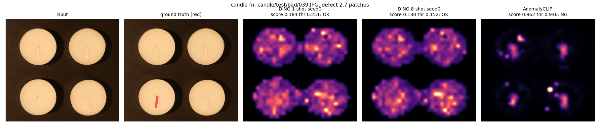

`candle/test/bad/039.JPG` · lowest-scoring anomalous image (DINO 1-shot seed 0) · label anomalous · defect size 2.69 patches

| Method | score vs threshold | Outcome |
|---|---|---|
| DINO 1-shot seed 0 | 0.184 vs 0.251 → **OK** | **FN** |
| DINO 8-shot seed 0 | 0.130 vs 0.152 → **OK** | **FN** |
| AnomalyCLIP | 0.962 vs 0.946 → **NG** | TP |

Claude's first pass (unconfirmed): Long thin defect near the wick. Both DINO maps show scattered wax-texture activity with no clear response on it. CLIP says NG, but its brightest spot is on a different candle, and its wick responses also appear on the normal candle_fp_0488. Its correct decision looks accidental.

**Your review**

- What I see:
- Error type (S/L/T/B/X/A/O):
- Agree with the first pass? (yes / no / n.a.):
- Use in the report? (yes / no):

## candle_fp_0488

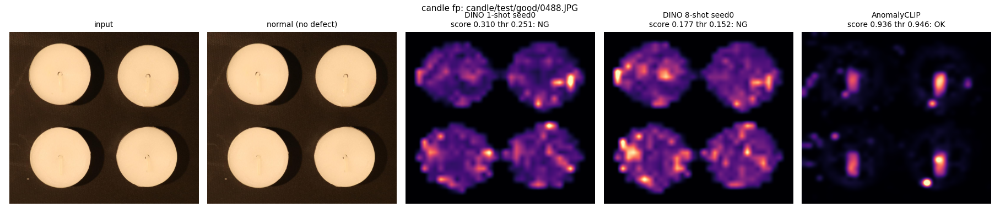

`candle/test/good/0488.JPG` · highest-scoring normal image (DINO 1-shot seed 0) · label normal · defect size — (normal image)

| Method | score vs threshold | Outcome |
|---|---|---|
| DINO 1-shot seed 0 | 0.310 vs 0.251 → **NG** | **FP** |
| DINO 8-shot seed 0 | 0.177 vs 0.152 → **NG** | **FP** |
| AnomalyCLIP | 0.936 vs 0.946 → **OK** | TN |

Claude's first pass (unconfirmed): Normal. DINO shows scattered activity on the wax surface and rims, with no visible defect.

**Your review**

- What I see:
- Error type (S/L/T/B/X/A/O):
- Agree with the first pass? (yes / no / n.a.):
- Use in the report? (yes / no):

## candle_small_059

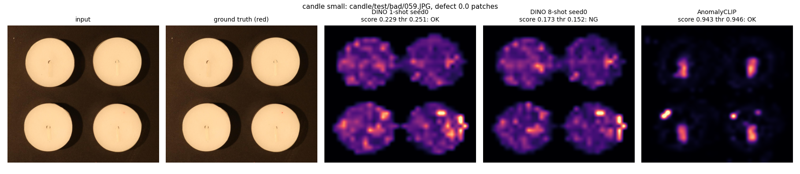

`candle/test/bad/059.JPG` · anomalous image with the smallest defect · label anomalous · defect size 0.02 patches

| Method | score vs threshold | Outcome |
|---|---|---|
| DINO 1-shot seed 0 | 0.229 vs 0.251 → **OK** | **FN** |
| DINO 8-shot seed 0 | 0.173 vs 0.152 → **NG** | TP |
| AnomalyCLIP | 0.943 vs 0.946 → **OK** | **FN** |

Claude's first pass (unconfirmed): — none, not yet looked at —

**Your review**

- What I see:
- Error type (S/L/T/B/X/A/O):
- Agree with the first pass? (yes / no / n.a.):
- Use in the report? (yes / no):

## capsules_fn_087

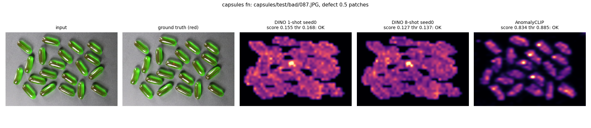

`capsules/test/bad/087.JPG` · lowest-scoring anomalous image (DINO 1-shot seed 0) · label anomalous · defect size 0.54 patches

| Method | score vs threshold | Outcome |
|---|---|---|
| DINO 1-shot seed 0 | 0.155 vs 0.168 → **OK** | **FN** |
| DINO 8-shot seed 0 | 0.127 vs 0.137 → **OK** | **FN** |
| AnomalyCLIP | 0.834 vs 0.885 → **OK** | **FN** |

Claude's first pass (unconfirmed): Missed by all three. DINO's peak coincides with the tiny marked region, but scores stay below threshold.

**Your review**

- What I see:
- Error type (S/L/T/B/X/A/O):
- Agree with the first pass? (yes / no / n.a.):
- Use in the report? (yes / no):

## capsules_fp_363

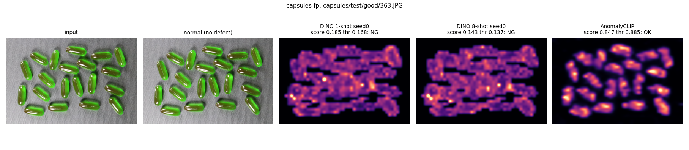

`capsules/test/good/363.JPG` · highest-scoring normal image (DINO 1-shot seed 0) · label normal · defect size — (normal image)

| Method | score vs threshold | Outcome |
|---|---|---|
| DINO 1-shot seed 0 | 0.185 vs 0.168 → **NG** | **FP** |
| DINO 8-shot seed 0 | 0.143 vs 0.137 → **NG** | **FP** |
| AnomalyCLIP | 0.847 vs 0.885 → **OK** | TN |

Claude's first pass (unconfirmed): — none, not yet looked at —

**Your review**

- What I see:
- Error type (S/L/T/B/X/A/O):
- Agree with the first pass? (yes / no / n.a.):
- Use in the report? (yes / no):

## capsules_small_038

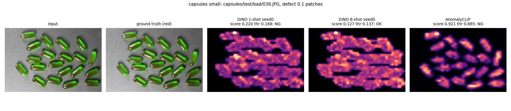

`capsules/test/bad/038.JPG` · anomalous image with the smallest defect · label anomalous · defect size 0.12 patches

| Method | score vs threshold | Outcome |
|---|---|---|
| DINO 1-shot seed 0 | 0.220 vs 0.168 → **NG** | TP |
| DINO 8-shot seed 0 | 0.127 vs 0.137 → **OK** | **FN** |
| AnomalyCLIP | 0.921 vs 0.885 → **NG** | TP |

Claude's first pass (unconfirmed): — none, not yet looked at —

**Your review**

- What I see:
- Error type (S/L/T/B/X/A/O):
- Agree with the first pass? (yes / no / n.a.):
- Use in the report? (yes / no):

## cashew_fn_063

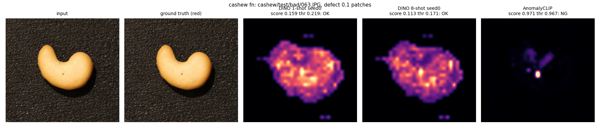

`cashew/test/bad/063.JPG` · lowest-scoring anomalous image (DINO 1-shot seed 0) · label anomalous · defect size 0.09 patches

| Method | score vs threshold | Outcome |
|---|---|---|
| DINO 1-shot seed 0 | 0.159 vs 0.219 → **OK** | **FN** |
| DINO 8-shot seed 0 | 0.113 vs 0.171 → **OK** | **FN** |
| AnomalyCLIP | 0.971 vs 0.967 → **NG** | TP |

Claude's first pass (unconfirmed): — none, not yet looked at —

**Your review**

- What I see:
- Error type (S/L/T/B/X/A/O):
- Agree with the first pass? (yes / no / n.a.):
- Use in the report? (yes / no):

## cashew_fp_130

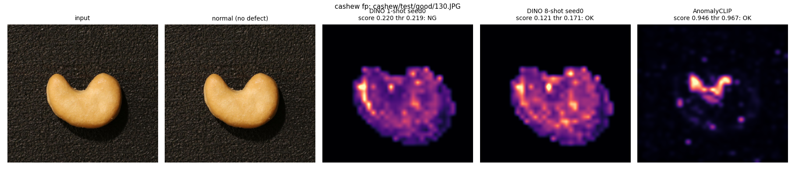

`cashew/test/good/130.JPG` · highest-scoring normal image (DINO 1-shot seed 0) · label normal · defect size — (normal image)

| Method | score vs threshold | Outcome |
|---|---|---|
| DINO 1-shot seed 0 | 0.220 vs 0.219 → **NG** | **FP** |
| DINO 8-shot seed 0 | 0.121 vs 0.171 → **OK** | TN |
| AnomalyCLIP | 0.946 vs 0.967 → **OK** | TN |

Claude's first pass (unconfirmed): — none, not yet looked at —

**Your review**

- What I see:
- Error type (S/L/T/B/X/A/O):
- Agree with the first pass? (yes / no / n.a.):
- Use in the report? (yes / no):

## cashew_small_055

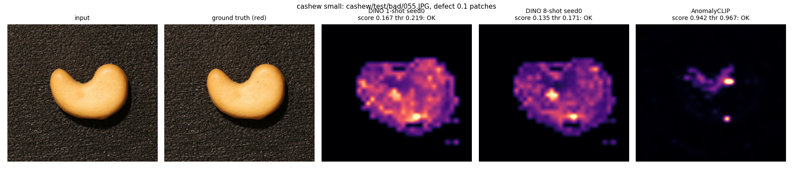

`cashew/test/bad/055.JPG` · anomalous image with the smallest defect · label anomalous · defect size 0.07 patches

| Method | score vs threshold | Outcome |
|---|---|---|
| DINO 1-shot seed 0 | 0.167 vs 0.219 → **OK** | **FN** |
| DINO 8-shot seed 0 | 0.135 vs 0.171 → **OK** | **FN** |
| AnomalyCLIP | 0.942 vs 0.967 → **OK** | **FN** |

Claude's first pass (unconfirmed): Defect is about 0.1 patch and barely visible. No method responds at it; peaks are elsewhere.

**Your review**

- What I see:
- Error type (S/L/T/B/X/A/O):
- Agree with the first pass? (yes / no / n.a.):
- Use in the report? (yes / no):

## chewinggum_fn_033

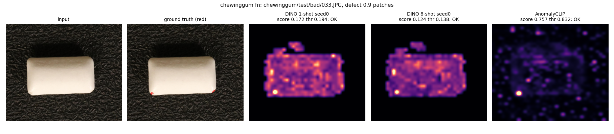

`chewinggum/test/bad/033.JPG` · lowest-scoring anomalous image (DINO 1-shot seed 0) · label anomalous · defect size 0.94 patches

| Method | score vs threshold | Outcome |
|---|---|---|
| DINO 1-shot seed 0 | 0.172 vs 0.194 → **OK** | **FN** |
| DINO 8-shot seed 0 | 0.124 vs 0.138 → **OK** | **FN** |
| AnomalyCLIP | 0.757 vs 0.832 → **OK** | **FN** |

Claude's first pass (unconfirmed): — none, not yet looked at —

**Your review**

- What I see:
- Error type (S/L/T/B/X/A/O):
- Agree with the first pass? (yes / no / n.a.):
- Use in the report? (yes / no):

## chewinggum_fp_467

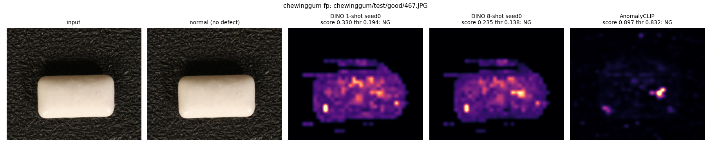

`chewinggum/test/good/467.JPG` · highest-scoring normal image (DINO 1-shot seed 0) · label normal · defect size — (normal image)

| Method | score vs threshold | Outcome |
|---|---|---|
| DINO 1-shot seed 0 | 0.330 vs 0.194 → **NG** | **FP** |
| DINO 8-shot seed 0 | 0.235 vs 0.138 → **NG** | **FP** |
| AnomalyCLIP | 0.897 vs 0.832 → **NG** | **FP** |

Claude's first pass (unconfirmed): Normal, flagged by all three. Strong response near the left end of the piece and on surface marks.

**Your review**

- What I see:
- Error type (S/L/T/B/X/A/O):
- Agree with the first pass? (yes / no / n.a.):
- Use in the report? (yes / no):

## chewinggum_small_070

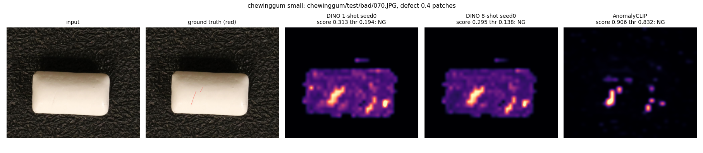

`chewinggum/test/bad/070.JPG` · anomalous image with the smallest defect · label anomalous · defect size 0.40 patches

| Method | score vs threshold | Outcome |
|---|---|---|
| DINO 1-shot seed 0 | 0.313 vs 0.194 → **NG** | TP |
| DINO 8-shot seed 0 | 0.295 vs 0.138 → **NG** | TP |
| AnomalyCLIP | 0.906 vs 0.832 → **NG** | TP |

Claude's first pass (unconfirmed): — none, not yet looked at —

**Your review**

- What I see:
- Error type (S/L/T/B/X/A/O):
- Agree with the first pass? (yes / no / n.a.):
- Use in the report? (yes / no):

## fryum_fn_031

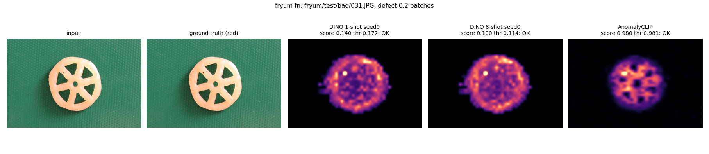

`fryum/test/bad/031.JPG` · lowest-scoring anomalous image (DINO 1-shot seed 0) · label anomalous · defect size 0.17 patches

| Method | score vs threshold | Outcome |
|---|---|---|
| DINO 1-shot seed 0 | 0.140 vs 0.172 → **OK** | **FN** |
| DINO 8-shot seed 0 | 0.100 vs 0.114 → **OK** | **FN** |
| AnomalyCLIP | 0.980 vs 0.981 → **OK** | **FN** |

Claude's first pass (unconfirmed): Peak on the small defect in both DINO maps, but the score stays below threshold.

**Your review**

- What I see:
- Error type (S/L/T/B/X/A/O):
- Agree with the first pass? (yes / no / n.a.):
- Use in the report? (yes / no):

## fryum_fp_239

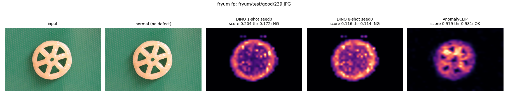

`fryum/test/good/239.JPG` · highest-scoring normal image (DINO 1-shot seed 0) · label normal · defect size — (normal image)

| Method | score vs threshold | Outcome |
|---|---|---|
| DINO 1-shot seed 0 | 0.204 vs 0.172 → **NG** | **FP** |
| DINO 8-shot seed 0 | 0.116 vs 0.114 → **NG** | **FP** |
| AnomalyCLIP | 0.979 vs 0.981 → **OK** | TN |

Claude's first pass (unconfirmed): — none, not yet looked at —

**Your review**

- What I see:
- Error type (S/L/T/B/X/A/O):
- Agree with the first pass? (yes / no / n.a.):
- Use in the report? (yes / no):

## fryum_small_038

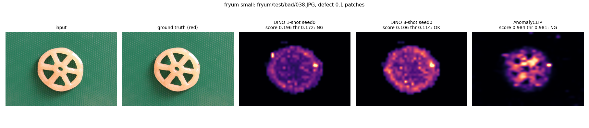

`fryum/test/bad/038.JPG` · anomalous image with the smallest defect · label anomalous · defect size 0.09 patches

| Method | score vs threshold | Outcome |
|---|---|---|
| DINO 1-shot seed 0 | 0.196 vs 0.172 → **NG** | TP |
| DINO 8-shot seed 0 | 0.106 vs 0.114 → **OK** | **FN** |
| AnomalyCLIP | 0.984 vs 0.981 → **NG** | TP |

Claude's first pass (unconfirmed): — none, not yet looked at —

**Your review**

- What I see:
- Error type (S/L/T/B/X/A/O):
- Agree with the first pass? (yes / no / n.a.):
- Use in the report? (yes / no):

## pipe_fryum_fn_050

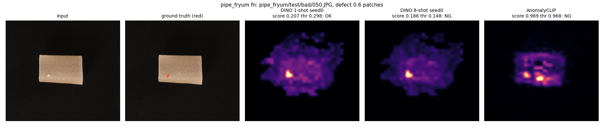

`pipe_fryum/test/bad/050.JPG` · lowest-scoring anomalous image (DINO 1-shot seed 0) · label anomalous · defect size 0.56 patches

| Method | score vs threshold | Outcome |
|---|---|---|
| DINO 1-shot seed 0 | 0.207 vs 0.298 → **OK** | **FN** |
| DINO 8-shot seed 0 | 0.186 vs 0.148 → **NG** | TP |
| AnomalyCLIP | 0.969 vs 0.968 → **NG** | TP |

Claude's first pass (unconfirmed): Clear localised peak. 1-shot misses it with a threshold of 0.298, well above its calibration median of 0.197. 8-shot catches it.

**Your review**

- What I see:
- Error type (S/L/T/B/X/A/O):
- Agree with the first pass? (yes / no / n.a.):
- Use in the report? (yes / no):

## pipe_fryum_fp_400

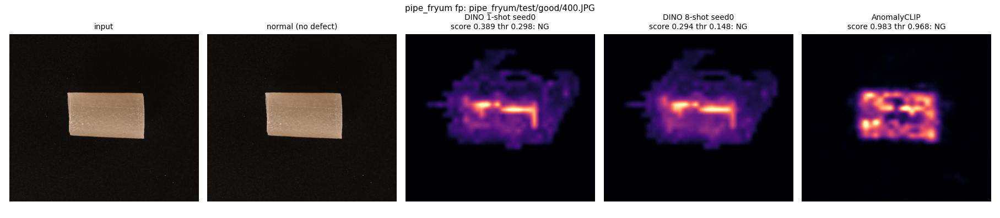

`pipe_fryum/test/good/400.JPG` · highest-scoring normal image (DINO 1-shot seed 0) · label normal · defect size — (normal image)

| Method | score vs threshold | Outcome |
|---|---|---|
| DINO 1-shot seed 0 | 0.389 vs 0.298 → **NG** | **FP** |
| DINO 8-shot seed 0 | 0.294 vs 0.148 → **NG** | **FP** |
| AnomalyCLIP | 0.983 vs 0.968 → **NG** | **FP** |

Claude's first pass (unconfirmed): Normal, flagged by all three. DINO's response follows the tube edges, which looks like a pose or shape difference from the references, and 8 shots do not remove it.

**Your review**

- What I see:
- Error type (S/L/T/B/X/A/O):
- Agree with the first pass? (yes / no / n.a.):
- Use in the report? (yes / no):

## pipe_fryum_small_039

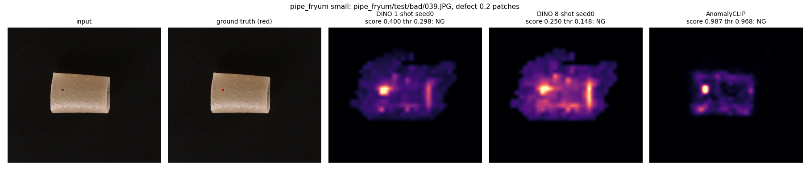

`pipe_fryum/test/bad/039.JPG` · anomalous image with the smallest defect · label anomalous · defect size 0.19 patches

| Method | score vs threshold | Outcome |
|---|---|---|
| DINO 1-shot seed 0 | 0.400 vs 0.298 → **NG** | TP |
| DINO 8-shot seed 0 | 0.250 vs 0.148 → **NG** | TP |
| AnomalyCLIP | 0.987 vs 0.968 → **NG** | TP |

Claude's first pass (unconfirmed): — none, not yet looked at —

**Your review**

- What I see:
- Error type (S/L/T/B/X/A/O):
- Agree with the first pass? (yes / no / n.a.):
- Use in the report? (yes / no):
