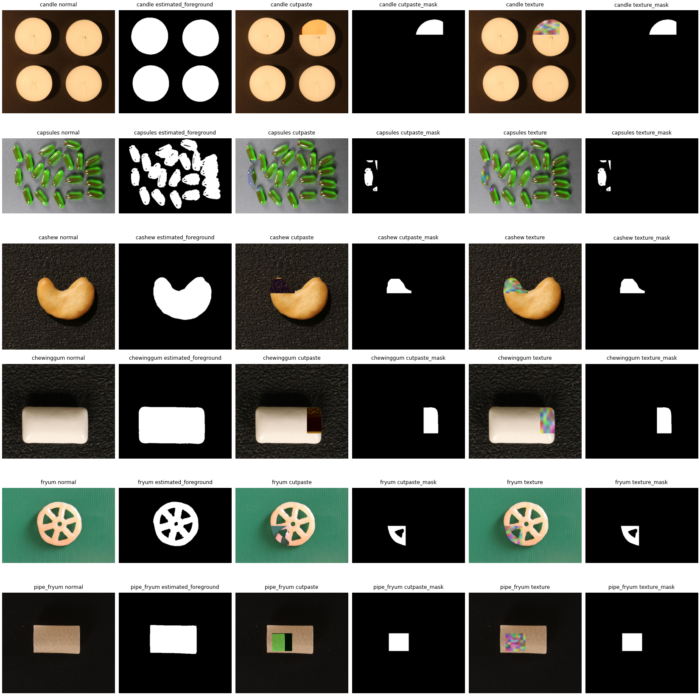

# 合成缺陷：准备完成，训练和真实缺陷评价尚未完成

下图使用六类各一张**正常训练池**图片，明确排除20张校准图与全部测试图。依次为正常图、估计产品区域、CutPaste-inspired 图及实际变化掩码、纹理图及实际变化掩码。示例路径、种子、区域占比及文件哈希记录在 `preparation.json`。

目前完成：可复现的两种增强、实际变化掩码、patch覆盖率标签、轻量评分头，以及只更新head/冻结骨干的梯度检查。没有使用测试 GT 找产品区域，也没有在 DINO 特征上训练。

初版全图随机贴块常落到背景上，已在训练图人工预览后修正：用正常图边缘颜色估计产品区域，在其中贴块。区域估计仍有缺口或包含背景的可能，不能当准确分割；`placement='canvas'` 保留为正式训练后的受控消融。尤其 Capsules 的反光/阴影可能使区域破碎，Fryum 的孔洞和绿色背景也需要继续检查。两种生成器是否能迁移到真实缺陷，必须接 B 的冻结 DINO 后用真实测试评价，不能靠这张图下结论。

下一步依赖：[A剩余任务与B交接清单](../../A剩余任务与B交接清单.md)。不需要等待 B 的 CLIP 或其他改进，但需要能处理新合成图的真实 DINO 特征接口；只有旧正常图缓存不够。
