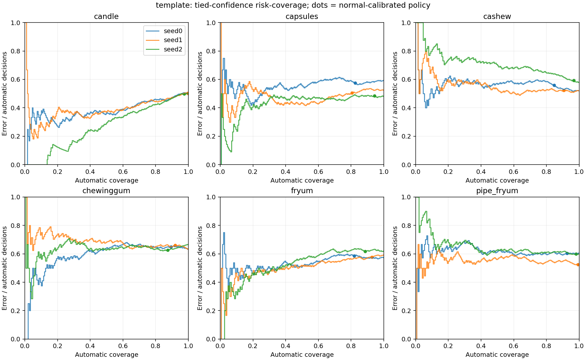
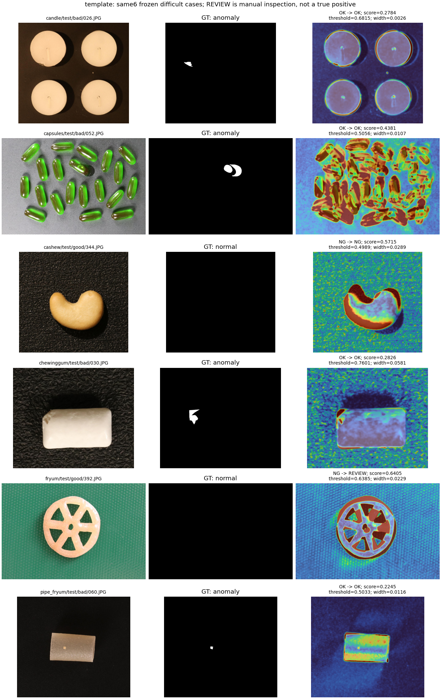

# template 的选择性预测：真实结果与限制

主展示设置：8-shot，六类等权，三个 seed；该方法完整的所有 shot 分析另见 summary.json。
本结果是在现有检测器上加复核策略，不是 DINO 实验。原分数、热图、Image/Pixel AUROC 均不变。

|策略|自动处理比例|自动判断错误率|自动漏检/全部异常|自动误报/全部正常|
|---|---:|---:|---:|---:|
|不复核|100.00%|56.48%|87.06%|5.17%|
|主方案：阈值两侧复核|91.58%|56.53%|80.83%|3.00%|
|消融：只复核阈值下侧|94.80%|55.37%|80.83%|5.17%|

主方案自动判断错误率上升；变化为 +0.051 个百分点。减少自动漏检数不代表模型学会了缺陷，一部分图只是转交人工。
测试 ROC 上实际可达到 FPR≤5% 的 FNR，六类三 seed 均值为 83.67%。这是使用测试标签计算的评价点，不是部署阈值。实际部署仍用20张正常校准图的95%分位数，测试 FPR 可以超过5%。

## 为什么复核不一定提高可靠性

该规则认为“靠近阈值”才不确定。但阈值由少量正常图估计，若异常图的分数远低于阈值，模型会很有把握地判错，并且不会送复核。正常校准图不能证明对真实异常的置信度可靠。扩大复核比例也不是免费收益，必须报告人工负担和剩余自动风险。
同覆盖率随机复核控制、完整逐图 REVIEW 决策、所有 risk–coverage 点及 AURC 见 runs/。每组随机控制固定种子，重复100次；不依赖标签挑样本。

AURC 使用按置信度整组接收同分样本的右阶梯面积；零覆盖时 risk 未定义，记录 null。每类先评价再等权，不把测试数量多的类别加权更大。
部署阈值与复核宽度均在测试标签评价前从校准分数冻结。没有根据本次风险曲线重新选参数。

## 固定困难案例：哪些送复核、哪些仍自动判错

复用原Template预先固定的六例，seed0；下面只展示实际策略输出，不把送复核说成正确检出。图中热图继承原检测器，仅可视化色标0..0.25，F没有改热图。

- `candle/test/bad/026.JPG`：真实异常，原判 OK，现在 OK。
- `capsules/test/bad/052.JPG`：真实异常，原判 OK，现在 OK。
- `cashew/test/good/344.JPG`：真实正常，原判 NG，现在 NG。
- `chewinggum/test/bad/030.JPG`：真实异常，原判 OK，现在 OK。
- `fryum/test/good/392.JPG`：真实正常，原判 NG，现在 REVIEW。
- `pipe_fryum/test/bad/060.JPG`：真实异常，原判 OK，现在 OK。

## 完成边界

这个检测器上的真实 F 计算、消融和数量核对已完成。需要 B 的新版 DINO 完整逐图/校准分数后，才能按分工完成未改 DINO 与 DINO+REVIEW 的正式比较。
